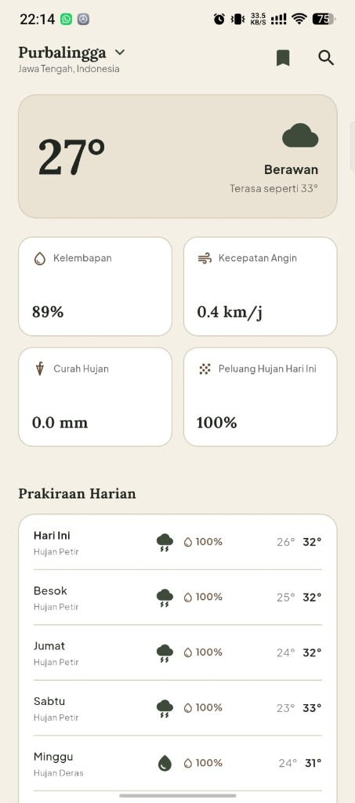
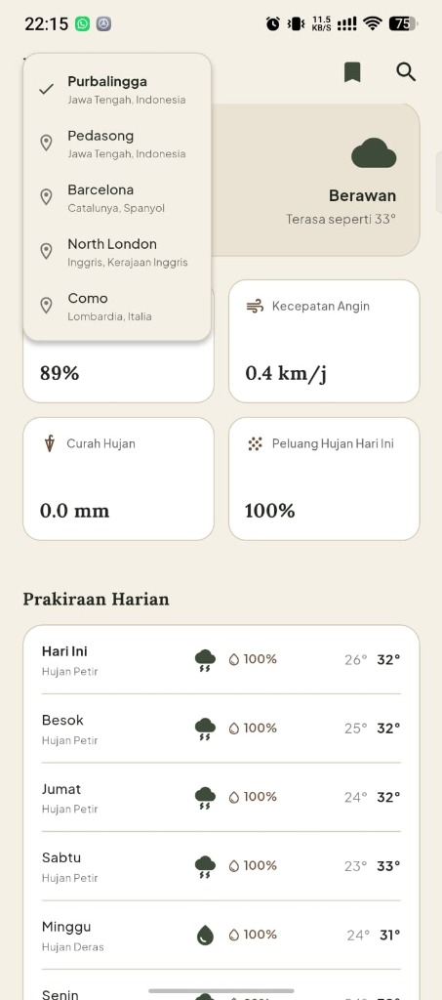
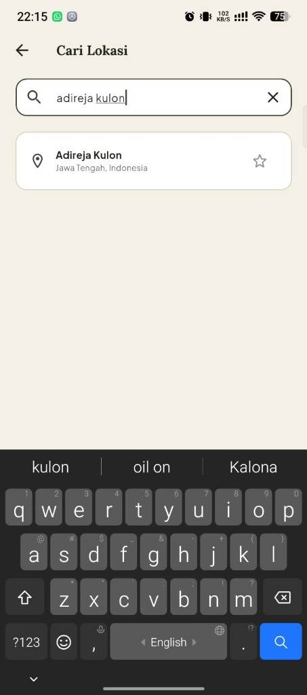
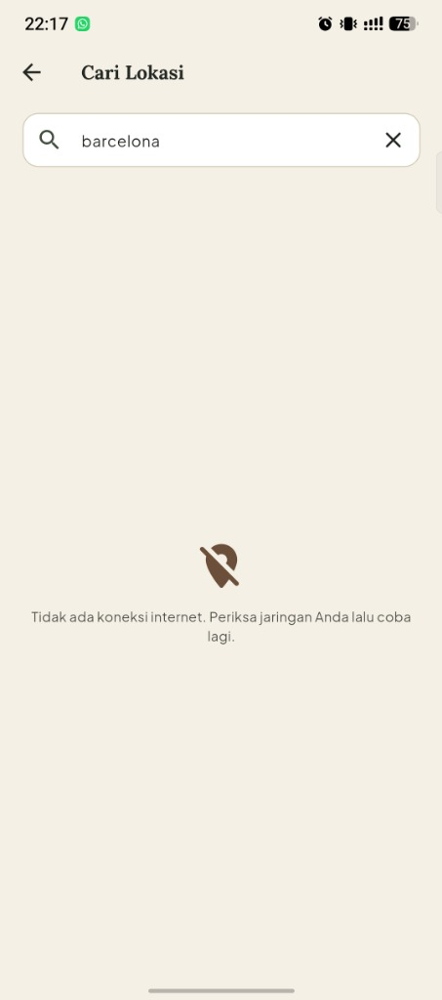

# Cuaca Nusantara — Aplikasi Cuaca Flutter (MVVM)

Aplikasi informasi cuaca berbasis Flutter yang menggunakan **Open-Meteo REST API** dengan arsitektur **Model-View-ViewModel (MVVM)**, state management **Provider**, serta penyimpanan lokal **SharedPreferences** untuk menyimpan kota favorit dan lokasi terakhir.

## Struktur Proyek (MVVM)

```text
lib/
├── main.dart                     # Entry point, Material 3 Theme (Earthy Sage & Cream), & ChangeNotifierProvider
├── models/
│   ├── location_model.dart       # Model data lokasi/kota (fromJson/toJson & fromMap/toMap)
│   └── weather_model.dart        # Model data cuaca current & prakiraan harian (daily)
├── services/
│   └── weather_service.dart      # HTTP GET ke Open-Meteo Geocoding API & Forecast API
├── utils/
│   └── weather_helper.dart       # Konversi kode cuaca WMO (0-99) ke deskripsi & ikon Material
├── viewmodels/
│   └── weather_viewmodel.dart    # ChangeNotifier: state loading/error, API calls, & SharedPreferences
└── views/
    ├── home_screen.dart          # Halaman utama: Hero suhu, Bento Grid 2x2, & prakiraan harian
    └── search_screen.dart        # Halaman pencarian kota & daftar kota favorit tersimpan
```

## Implementasi API (Open-Meteo)

1. **Geocoding API** (`https://geocoding-api.open-meteo.com/v1/search`)
   - Parameter: `name`, `count=10`, `language=id`, `format=json`
   - Digunakan pada `SearchScreen` untuk mencari kota secara langsung dari API.
2. **Weather Forecast API** (`https://api.open-meteo.com/v1/forecast`)
   - Parameter: `latitude`, `longitude`, `timezone=auto`
   - `current`: `temperature_2m`, `relative_humidity_2m`, `apparent_temperature`, `precipitation`, `weather_code`, `wind_speed_10m`
   - `daily`: `weather_code`, `temperature_2m_max`, `temperature_2m_min`, `precipitation_probability_max`

## Alur Penerapan MVVM

- **Model**: `LocationModel` dan `WeatherModel` memetakan JSON dari Open-Meteo dan data lokal `SharedPreferences` menjadi objek Dart.
- **Service**: `WeatherService` menangani request `http.get` dan melempar `Exception` berbahasa Indonesia jika terjadi gangguan jaringan atau error HTTP.
- **ViewModel**: `WeatherViewModel` mengelola state (`isLoading`, `isSearching`, `errorMessage`, `currentWeather`, `selectedLocation`, `searchResults`, `favoriteLocations`), memuat lokasi default (**Purbalingga**), serta memanggil `notifyListeners()` saat state berubah.
- **View**: `HomeScreen` dan `SearchScreen` bersifat reaktif menggunakan `Consumer<WeatherViewModel>` tanpa logika bisnis atau pemanggilan HTTP langsung di UI.

## Screenshot Aplikasi

| Halaman Utama (`HomeScreen`) | Dropdown Kota Favorit | Halaman Pencarian (`SearchScreen`) | State Error / Offline |
| :---: | :---: | :---: | :---: |
|  |  |  |  |
